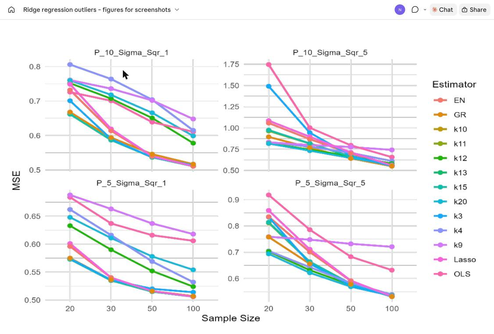
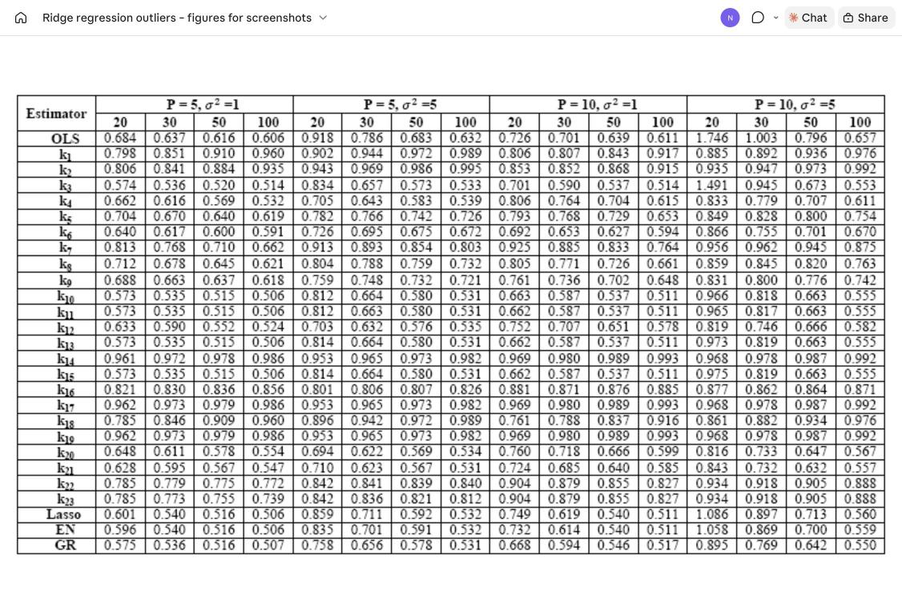
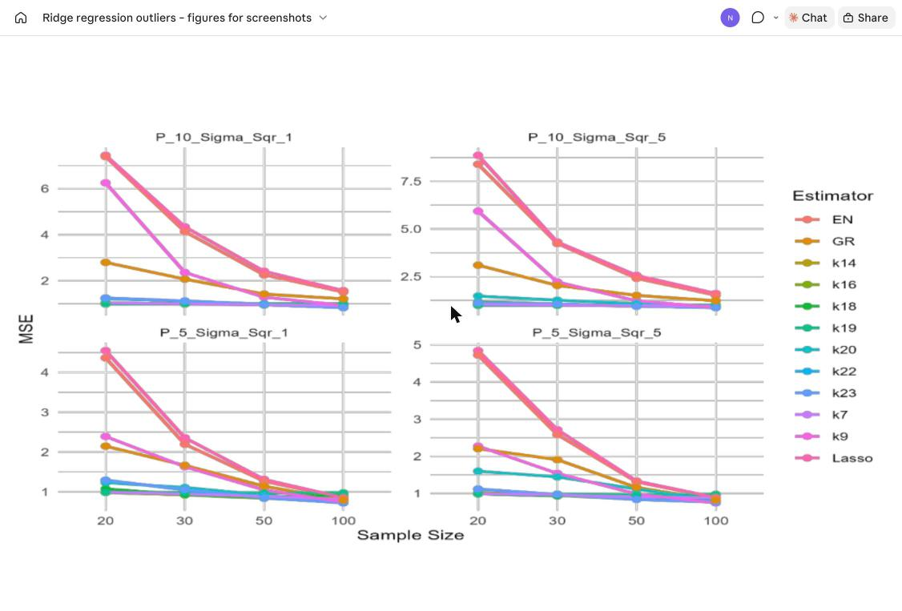
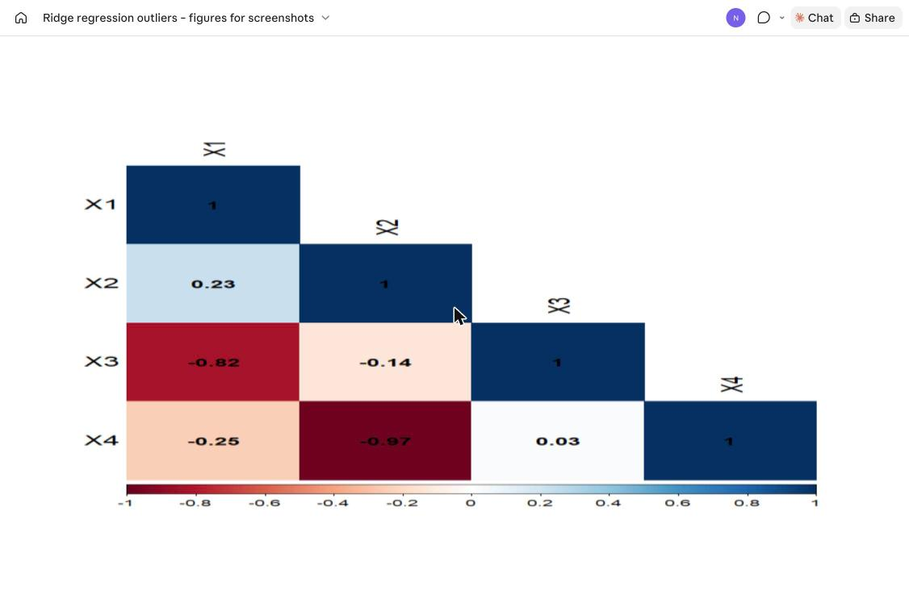

# Ridge Regression with Outliers

**Comparison among Ordinary Least Squares, Ridge, Lasso, and Elastic Net Estimators in the Presence of Outliers: Simulation and Application**

HM Nayem, Sajeda Aziz, B. M. Golam Kibria (2024). *International Journal of Statistical Sciences*, 24(2) (Special), 25-48.

[](https://doi.org/10.3329/ijss.v24i20.78212)


---

## Summary

Multicollinearity inflates the variance of the OLS estimator, and outliers in the response make it worse. This paper compares OLS with **23 ridge-parameter (k) estimators**, the **generalized ridge (GR)**, **Lasso** and **Elastic Net (EN)** through an extensive Monte Carlo study, using the **average mean squared error (AMSE)** as the criterion, both with and without outliers. Two classic real data sets (Portland cement and Longley) illustrate the findings.

**Main findings**

- **No outliers, small n, moderate-to-high collinearity (rho around 0.95):** ridge estimators k10, k11, k13 and k15 perform best.
- **With outliers, small n and high error variance:** k7, k16, k22 and k23 perform best.
- **Large samples:** GR, Elastic Net and Lasso give the lowest AMSE.
- All shrinkage estimators clearly beat OLS when collinearity is severe.

## Simulation design

| Factor | Levels |
|---|---|
| Predictors p | 5, 10 |
| Correlation rho | 0.90, 0.95, 0.99 |
| Sample size n | 20, 30, 50, 100 |
| Error variance sigma^2 | 1, 5 |
| Outliers in y | 0%, 10%, 25% |
| Replications N | 5000 |
| True coefficients | beta = (1, ..., 1) |

Predictors are generated as x_ij = sqrt(1 - rho^2) z_ij + rho z_ip (McDonald & Galarneau, 1975; Gibbons, 1981). Outliers are created by adding a N(10, 5^2) shock to a random subset of the responses.

## Estimators

| Paper | Code name | Description / source |
|---|---|---|
| k1 | k27 | Mermi et al. (2024) |
| k2 | k44 | Mermi et al. (2024) |
| k3 | k49 | Mermi et al. (2024) |
| k4 | k133 | Mermi et al. (2024) |
| k5 | k13 | median of sigma^2/beta_i^2 + 1/lambda_i (Kibria, 2023) |
| k6 | k105 | maximum (Kibria, 2023) |
| k7 | k104 | minimum (Kibria, 2023) |
| k8 | k106 | geometric mean (Kibria, 2023) |
| k9 | k107 | harmonic mean (Kibria, 2023) |
| k10 | k243 | Mermi et al. (2024) |
| k11 | k126 | Mermi et al. (2024) |
| k12 | k117 | Mermi et al. (2024) |
| k13 | k231 | Mermi et al. (2024) |
| k14 | k108 | Mermi et al. (2024) |
| k15 | k239 | Mermi et al. (2024) |
| k16 | k211 | Mermi et al. (2024) |
| k17 | k284 | Mermi et al. (2024) |
| k18 | k29 | Mermi et al. (2024) |
| k19 | k190 | Mermi et al. (2024) |
| k20 | k143 | Mermi et al. (2024) |
| k21 | k151 | Mermi et al. (2024) |
| k22 | Kck1 | sigma * p^(1 + p/n) (Kibria & Lukman, 2020) |
| k23 | Kck | sigma * max(p^(1 + p/n), p^(1 + 1/p)) (Kibria & Lukman, 2020) |
| - | OLS, Lasso, ElasticNet, OptimalRidge | `lm`, `cv.glmnet` (alpha = 1, 0.5, 0) |

k1-k4 and k10-k21 are the 16 best of the 366 estimators reviewed by Mermi et al. (2024).

## Selected results

**Figure 3.1** - AMSE, p = 5, rho = 0.90, no outliers



**Table 3.1.1** - AMSE, rho = 0.90, no outliers



**Figure 3.4** - AMSE, rho = 0.99, 25% outliers



## Data

### Portland cement (`data/portland_cement.csv`)

13 observations of the heat evolved while cement hardens (Woods, Steinour & Starke, 1932).

| Column | Description |
|---|---|
| Y | Heat evolved after 180 days (calories per gram of cement) |
| X1 | Tricalcium aluminate (%) |
| X2 | Tricalcium silicate (%) |
| X3 | Tetracalcium aluminoferrite (%) |
| X4 | Dicalcium silicate (%) |

VIFs are 38.5, 254.4, 46.9 and 282.5, and the condition number is 423.73, so collinearity is severe.



### Longley

The Longley macroeconomic data (16 observations) ship with R as `datasets::longley`. VIFs reach 639 and the condition number is 293,682.5; observations 6, 10 and 16 (18.75%) are flagged as outliers.

## Repository structure

```
Ridge-Regression-Outliers/
├── R/
│   ├── simulation_no_outliers.R     # Monte Carlo study without outliers
│   └── simulation_with_outliers.R   # Monte Carlo study with 10% / 25% outliers
├── data/
│   └── portland_cement.csv
├── docs/                            # figures and tables from the paper
└── README.md
```

## How to run

```r
install.packages(c("MASS", "glmnet", "pls", "caret", "openxlsx", "psych"))
source("R/simulation_no_outliers.R")
source("R/simulation_with_outliers.R")
```

Before running:

- Set `num_simulations` to the number of replications you want (the paper uses 5000; the outlier script ships with 2 for a quick test run).
- Edit the `write.csv()` path at the end of each script to a folder on your machine.
- The scripts loop over a wider grid (p = 3, 5, 10; rho = 0.80-0.99; n up to 200) than the paper reports, so a full run takes a long time. Trim `p_values`, `rho_values` and `sample_sizes` to match the paper's design.

## Citation

```bibtex
@article{nayem2024comparison,
  title   = {Comparison among Ordinary Least Squares, Ridge, Lasso, and Elastic Net Estimators in the Presence of Outliers: Simulation and Application},
  author  = {Nayem, HM and Aziz, Sajeda and Kibria, B. M. Golam},
  journal = {International Journal of Statistical Sciences},
  volume  = {24},
  number  = {2 (Special)},
  pages   = {25--48},
  year    = {2024},
  doi     = {10.3329/ijss.v24i20.78212}
}
```

## References

Full reference list of the paper (57 entries).

[1] Alin, A. (2010). Multicollinearity. Wiley Interdisciplinary Reviews: Computational Statistics, 2(3), 370–374. https://doi.org/10.1002/wics.84

[2] Alkhamisi, M. A., and Shukur, G. (2007). A Monte Carlo Study of Recent Ridge Parameters. Communications in Statistics - Simulation and Computation, 36(3), 535–547. https://doi.org/10.1080/03610910701208619

[3] Alkhamisi, M., Khalaf, G., and Shukur, G. (2006). Some Modifications for Choosing Ridge Parameters. Communications in Statistics - Theory and Methods, 35(11), 2005–2020. https://doi.org/10.1080/03610920600762905

[4] Arashi, M., and Valizadeh, T. (2015a). Performance of Kibria’s methods in partial linear ridge regression model. Statistical Papers, 56(1), 231–246. https://doi.org/10.1007/s00362-014-0578-6

[5] Arashi, M., and Valizadeh, T. (2015b). Performance of Kibria’s methods in partial linear ridge regression model. Statistical Papers, 56(1), 231–246. https://doi.org/10.1007/s00362-014-0578-6

[6] Aslam, M. (2014a). Performance of Kibria’s Method for the Heteroscedastic Ridge Regression Model: Some Monte Carlo Evidence. Communications in Statistics - Simulation and Computation, 43(4), 673–686. https://doi.org/10.1080/03610918.2012.712185

[7] Aslam, M. (2014b). Performance of Kibria’s Method for the Heteroscedastic Ridge Regression Model: Some Monte Carlo Evidence. Communications in Statistics - Simulation and Computation, 43(4), 673–686. https://doi.org/10.1080/03610918.2012.712185

[8] Ayinde, K., and Lukman, A. F. (2016). Review and classifications of the ridge parameter estimation techniques. Hacettepe Journal of Mathematics and Statistics, 46(113), 1–1. https://doi.org/10.15672/HJMS.201815671

[9] Chen, A.-C., and Emura, T. (2017). A modified Liu-type estimator with an intercept term under mixture experiments. Communications in Statistics - Theory and Methods, 46(13), 6645–6667. https://doi.org/10.1080/03610926.2015.1132327

[10] Damodar, N. and Gujarati, D. C. P. (2013). Basic Econometrics. In Introductory Econometrics: A Practical Approach.

[11] Dempster, A. P., Schatzoff, M., and Wermuth, N. (1977). A Simulation Study of Alternatives to Ordinary Least Squares: Rejoinder. Journal of the American Statistical Association, 72(357), 104. https://doi.org/10.2307/2286916

[12] Dorugade, A. V. (2016). Adjusted ridge estimator and comparison with Kibria’s method in linear regression. Journal of the Association of Arab Universities for Basic and Applied Sciences, 21(1), 96–102. https://doi.org/10.1016/j.jaubas.2015.04.002

[13] Dorugade, A. V. (2014). On Comparison of Some Ridge Parameters in Ridge Regression. Sri Lankan Journal of Applied Statistics, 15(1), 31. https://doi.org/10.4038/sljastats.v15i1.6792

[14] Emmert-Streib, F., and Dehmer, M. (2019). High-Dimensional LASSO-Based Computational Regression Models: Regularization, Shrinkage, and Selection. Machine Learning and Knowledge Extraction, 1(1), 359–383. https://doi.org/10.3390/make1010021

[15] Emura, T., Matsumoto, K., Uozumi, R., and Michimae, H. (2024). g.ridge: An R Package for Generalized Ridge Regression for Sparse and High-Dimensional Linear Models. Symmetry, 16(2), 223. https://doi.org/10.3390/sym16020223

[16] Fu, W., and Knight, K. (2000). Asymptotics for lasso-type estimators. The Annals of Statistics, 28(5). https://doi.org/10.1214/aos/1015957397

[17] Gibbons, D. G. (1981). A Simulation Study of Some Ridge Estimators. Journal of the American Statistical Association, 76(373), 131–139. https://doi.org/10.1080/01621459.1981.10477619

[18] Grewal, R., Cote, J. A., and Baumgartner, H. (2004). Multicollinearity and measurement error in structural equation models: Implications for theory testing. Marketing Science, 23(4). https://doi.org/10.1287/mksc.1040.0070

[19] Hadi, A. S., and Ling, R. F. (1998). Some Cautionary Notes on the Use of Principal Components Regression. The American Statistician, 52(1), 15–19. https://doi.org/10.1080/00031305.1998.10480530

[20] Hefnawy, A. El, and Farag, A. (2014). A Combined Nonlinear Programming Model and Kibria Method for Choosing Ridge Parameter Regression. Communications in Statistics - Simulation and Computation, 43(6), 1442–1470. https://doi.org/10.1080/03610918.2012.735317

[21] Herawati, N., Nisa, K., and Setiawan, E. (2018). Regularized Multiple Regression Methods to Deal with Severe Multicollinearity. International Journal of Statistics and Applications, 8(4), 167–172. https://doi.org/10.5923/j.statistics.20180804.02

[22] Herawati, N., Wijayanti, A., Sutrisno, A., Nusyirwan, and Misgiyati. (2024). The Performance of Ridge Regression, LASSO, and Elastic-Net in Controlling Multicollinearity: A Simulation and Application. Journal of Modern Applied Statistical Methods, 23(2), 2–12. https://doi.org/10.56801/Jmasm.V23.i2.4

[23] Hoerl, A. E., Kannard, R. W., and Baldwin, K. F. (1975). Ridge regression: Some simulations. Communications in Statistics, 4(2), 105–123. https://doi.org/10.1080/03610927508827232

[24] Hoerl, A. E., and Kennard, R. W. (1970). Ridge Regression: Biased Estimation for Nonorthogonal Problems. Technometrics, 12(1), 55–67. https://doi.org/10.1080/00401706.1970.10488634

[25] Hoque, M. A., and Golam Kibria, B. M. (2023). Some One and Two Parameter Estimators for the Multicollinear Gaussian Linear Regression Model: Simulations and Applications. Surveys in Mathematics and Its Applications, 18, 183–221.

[26] Hoque, M. A., and Kibria, B. M. G. (2024). Performance of some estimators for the multicollinear logistic regression model: theory, simulation, and applications. Research in Statistics, 2(1). https://doi.org/10.1080/27684520.2024.2364747

[27] J. F., L., and P, W. (1976). A simulation study of ridge and other regression estimators. Communications in Statistics - Theory and Methods, 5(4), 307–323. https://doi.org/10.1080/03610927608827353

[28] Khalaf, G., and Shukur, G. (2005). Choosing Ridge Parameter for Regression Problems. Communications in Statistics - Theory and Methods, 34(5), 1177–1182. https://doi.org/10.1081/STA-200056836

[29] Kibria, B. M. G. (2003). Performance of Some New Ridge Regression Estimators. Communications in Statistics - Simulation and Computation, 32(2), 419–435. https://doi.org/10.1081/SAC-120017499

[30] Kibria, B. M. G. (2023). More than hundred (100) estimators for estimating the shrinkage parameter in a linear and generalized linear ridge regression models. Journal of Econometrics and Statistics, 2(2), 233–252.

[31] Kibria, B. M. G, and Lukman, A. F. (2020). A new ridge-type estimator for the linear regression model: Simulations and applications. Scientifica, 2020. https://doi.org/10.1155/2020/9758378

[32] Kibria, B. M. G., Månsson, K., and Shukur, G. (2012). Performance of Some Logistic Ridge Regression Estimators. Computational Economics, 40(4), 401–414. https://doi.org/10.1007/s10614-011-9275-x

[33] Li, Y. F., Xie, M., and Goh, T. N. (2010). Adaptive ridge regression system for software cost estimating on multi-collinear datasets. Journal of Systems and Software, 83(11), 2332–2343. https://doi.org/10.1016/j.jss.2010.07.032

[34] Liu, W., and Li, Q. (2017). An efficient elastic net with regression coefficients method for variable selection of spectrum data. PLoS ONE, 12(2), 1–13. https://doi.org/10.1371/journal.pone.0171122

[35] Longley, J. W. (1967). An Appraisal of Least Squares Programs for the Electronic Computer from the Point of View of the User. Journal of the American Statistical Association, 62(319), 819–841. https://doi.org/10.1080/01621459.1967.10500896

[36] Lounici, K. (2008). Sup-norm convergence rate and sign concentration property of Lasso and Dantzig estimators. Electronic Journal of Statistics, 2. https://doi.org/10.1214/08-EJS177

[37] Lukman, A. F., Ayinde, K., Binuomote, S., and Clement, O. A. (2019). Modified ridge-type estimator to combat multicollinearity: Application to chemical data. Journal of Chemometrics, 33(5). https://doi.org/10.1002/cem.3125

[38] Lukman, A. F., and Ayinde, K. (2017). Review and classifications of the ridge parameter estimation techniques. Hacettepe Journal of Mathematics and Statistics, 46(5), 953–968. https://doi.org/10.15672/HJMS.201815671

[39] Lukman, A. F., Oluyemi, O. A., Akanbi, O. B., and Clement, O. A. (2018). Classification-Based Ridge Estimation Techniques of Alkhamisi Methods. Journal of Probability and Statistical Science, 16(2), 165–181.

[40] Månsson, K., Shukur, G., and Golam Kibria, B. M. G. (2010). A Simulation Study of Some Ridge Regression Estimators under Different Distributional Assumptions. Communications in Statistics - Simulation and Computation, 39(8), 1639–1670. https://doi.org/10.1080/03610918.2010.508862

[41] McDonald, G. C., and Galarneau, D. I. (1975). A Monte Carlo Evaluation of Some Ridge-Type Estimators. Journal of the American Statistical Association, 70(350), 407–416. https://doi.org/10.1080/01621459.1975.10479882

[42] McDonald, G. C., and Schwing, R. C. (1973). Instabilities of Regression Estimates Relating Air Pollution to Mortality. Technometrics, 15(3), 463–481. https://doi.org/10.1080/00401706.1973.10489073

[43] Melkumova, L. E., and Shatskikh, S. Y. (2017). Comparing Ridge and LASSO estimators for data analysis. Procedia Engineering, 201, 746–755. https://doi.org/10.1016/j.proeng.2017.09.615

[44] Mermi, S., Akkuş, Ö., Göktaş, A., and Gündüz, N. (2024). A new robust ridge parameter estimator having no outlier and ensuring normality for linear regression model. Journal of Radiation Research and Applied Sciences, 17(1), 100788. https://doi.org/10.1016/j.jrras.2023.100788

[45] Mermi, S., Göktaş, A., and Akkuş, Ö. (2021). Are most proposed ridge parameter estimators skewed and do they have any effect on MSE values? Journal of Statistical Computation and Simulation, 91(10), 2074–2093. https://doi.org/10.1080/00949655.2021.1883611

[46] Muniz, G., and Kibria, B. M. G. (2009). On Some Ridge Regression Estimators: An Empirical Comparisons. Communications in Statistics - Simulation and Computation, 38(3), 621–630. https://doi.org/10.1080/03610910802592838

[47] Muniz, G., Kibria, B. M. G., Mansson, K., and Shukur, G. (2012). On developing ridge regression parameters: A graphical investigation. SORT, 36(2), 115–138.

[48] Nayem, H. M., and Kibria, B. M. G. (2024). A simulation study on some confidence Intervals for Estimating the Population Mean Under Asymmetric and Symmetric Distribution Conditions. Journal of Statistics Applications & Probability Letters, 11(3), 123–144.

[49] Park, H., and Konishi, S. (2016). Robust logistic regression modelling via the elastic net-type regularization and tuning parameter selection. Journal of Statistical Computation and Simulation, 86(7), 1450–1461. https://doi.org/10.1080/00949655.2015.1073290

[50] Tibshirani, R. (1996). Regression Shrinkage and Selection Via the Lasso. Journal of the Royal Statistical Society Series B: Statistical Methodology, 58(1), 267–288. https://doi.org/10.1111/j.2517-6161.1996.tb02080.x

[51] Trenkler, G., and Toutenburg, H. (1990). Mean squared error matrix comparisons between biased estimators — An overview of recent results. Statistical Papers, 31(1), 165–179. https://doi.org/10.1007/BF02924687

[52] Walker, E., and Birch, J. B. (1988). Influence Measures in Ridge Regression. Technometrics, 30(2), 221–227. https://doi.org/10.1080/00401706.1988.10488370

[53] Yang, S.-P., and Emura, T. (2017). A Bayesian approach with generalized ridge estimation for high-dimensional regression and testing. Communications in Statistics - Simulation and Computation, 46(8), 6083–6105. https://doi.org/10.1080/03610918.2016.1193195

[54] Yousif, H., Eledum, A., and Alkhalifa, A. A. (2012). Generalized Two Stages Ridge regression Estimator GTR for Multicollinearity and Autocorrelated Errors. Canadian Journal on Science and Engineering Mathematics, 3(3), 79–84.

[55] Yuan, M., and Lin, Y. (2007). On the Non-Negative Garrotte Estimator. Journal of the Royal Statistical Society Series B: Statistical Methodology, 69(2), 143–161. https://doi.org/10.1111/j.1467-9868.2007.00581.x

[56] Yüzbaşı, B., Arashi, M., and Ejaz Ahmed, S. (2020). Shrinkage Estimation Strategies in Generalised Ridge Regression Models: Low/High-Dimension Regime. International Statistical Review, 88(1), 229–251. https://doi.org/10.1111/insr.12351

[57] Zou, H., and Hastie, T. (2005). Regularization and variable selection via the elastic net. Journal of the Royal Statistical Society Series B: Statistical Methodology, 67(2), 301–320. https://doi.org/10.1111/j.1467-9868.2005.00503.x

Portland cement data source (not in the paper's list): Woods, H., Steinour, H. H., and Starke, H. R. (1932). Effect of composition of Portland cement on heat evolved during hardening. Industrial and Engineering Chemistry, 24(11), 1207–1214. https://doi.org/10.1021/ie50275a002

## Contact

HM Nayem - Department of Mathematics and Statistics, Florida International University
